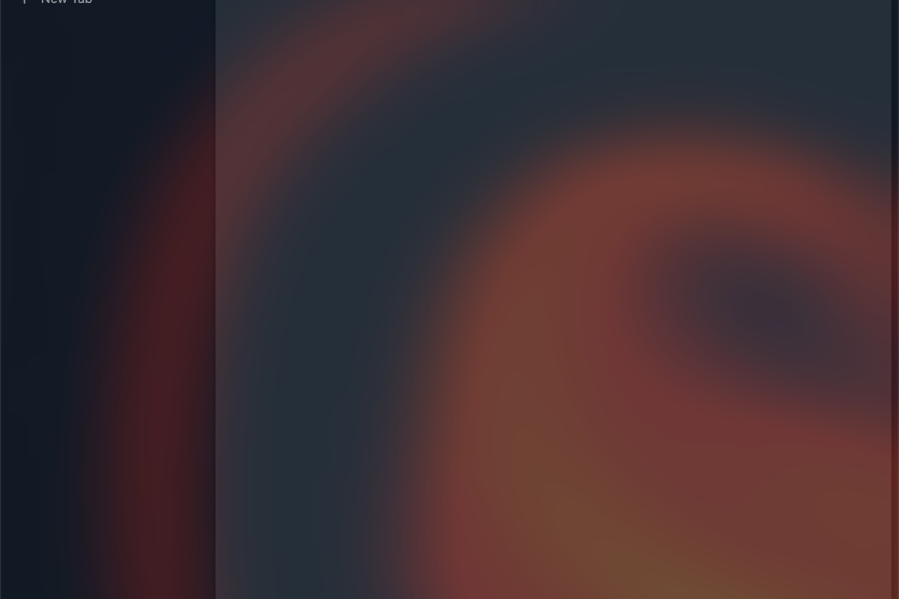

# Liquid Glass

Frosted glass and micro-interactions for Zen: tabs, toolbar buttons, compact mode sidebar, address bar results and panels.

## What it does

- **Active tab** becomes a glass pane; other tabs lift slightly on hover and press in on click
- **New tabs** bounce in; the tab icon "breathes" while the page loads
- **Toolbar buttons** with a springy hover and click effect
- **Compact mode sidebar** blurred over the page
- **Address bar results** cascade in one after another
- **Menus and panels** with matching corners and borders
- Automatic light and dark mode

## Options

| Option | Default | Notes |
|---|---|---|
| Glass | Normal | Fully transparent / More transparent / Normal / More frosted |
| Blur | Medium | "Strong" is heavier on the GPU |
| Page transparency | None | Lets the background show through the page. Off in fullscreen |
| Disable edge highlights | off | Flatter look |
| Disable animations | off | Also turned off automatically by the system "Reduce motion" setting |

## Limits

- Blur is only really visible where the UI **floats over the page** (floating address bar, compact mode sidebar). Over a solid background it just looks like a tint.
- No "lens" refraction: Firefox doesn't support SVG filters in `backdrop-filter`.
- Menus are separate windows and can't blur what's behind them, so they stay nearly opaque. On macOS, context menus are native and aren't styled.
- To keep the glass when Zen is not the focused window, set `zen.view.grey-out-inactive-windows` to `false` in `about:config`: a mod can't change it.

